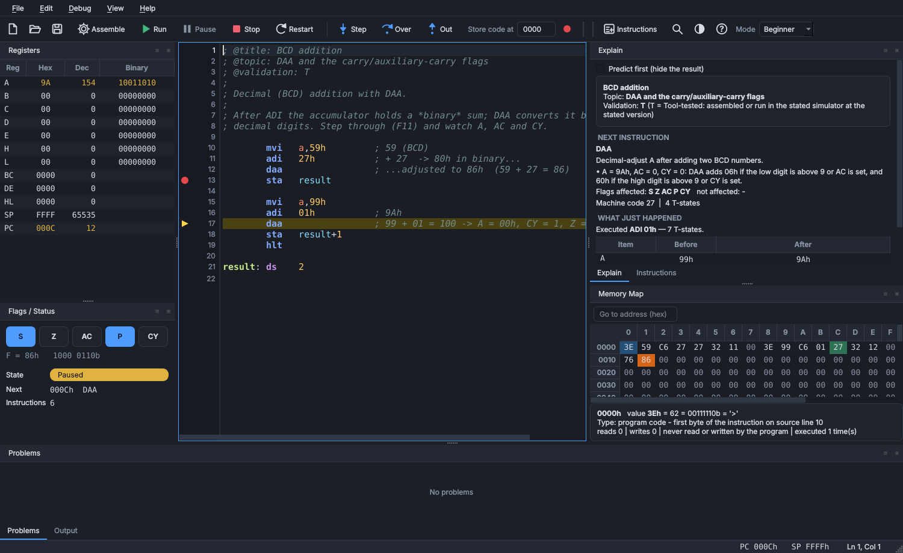
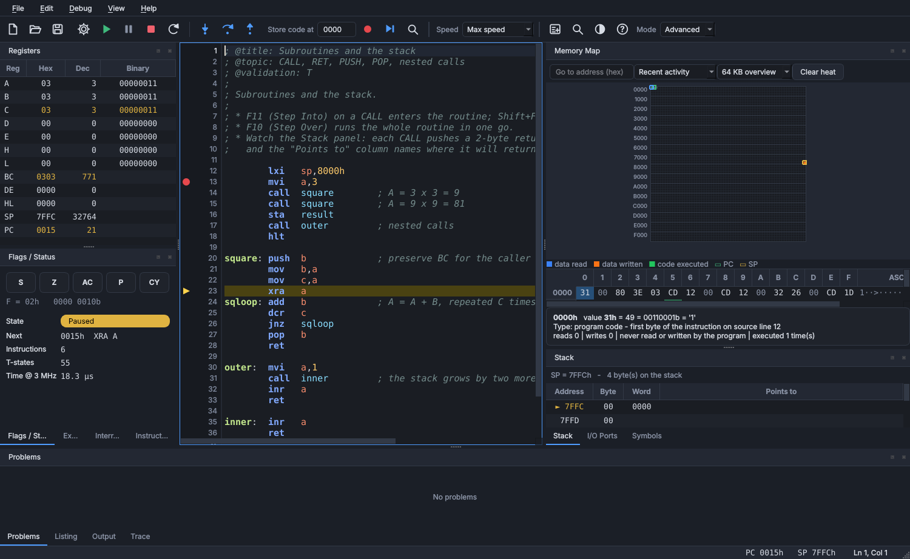
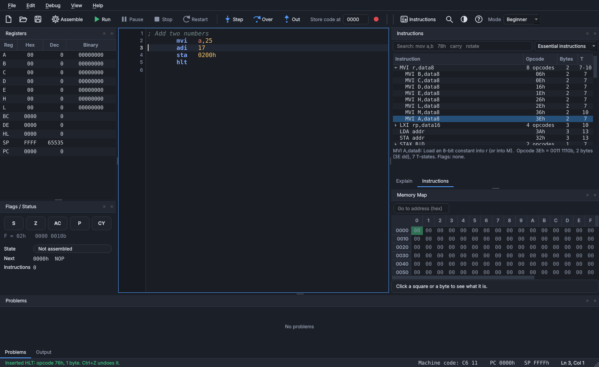
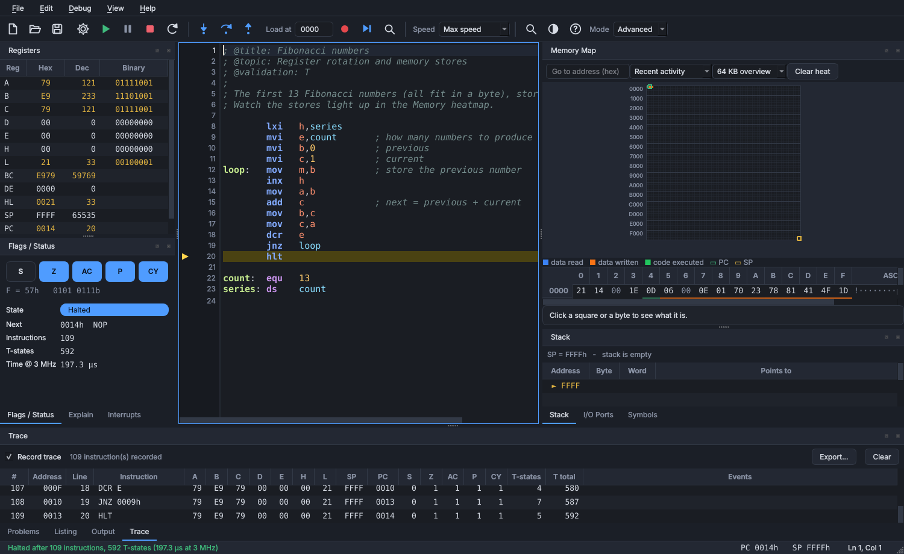
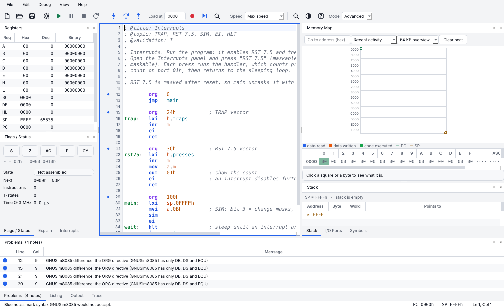
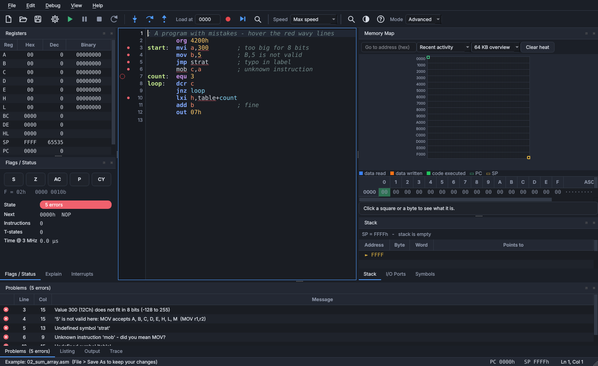
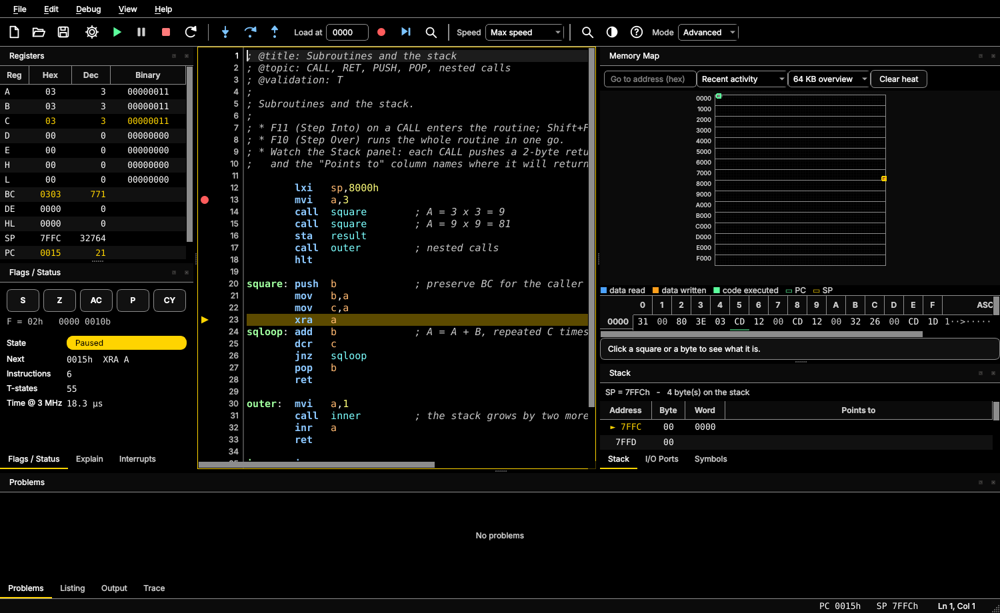
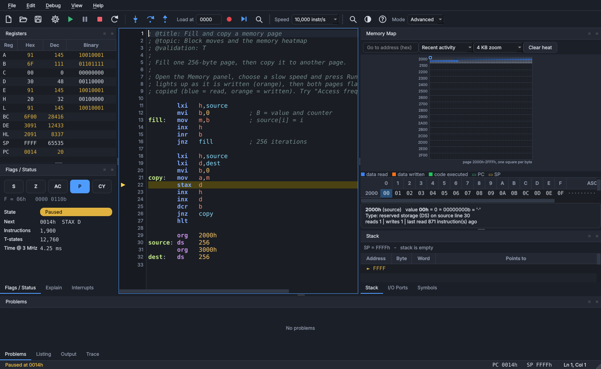
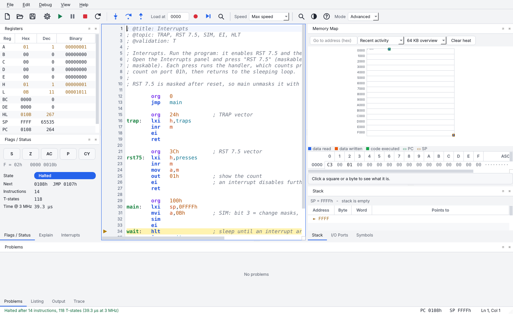

# 8085 Studio

A modern assembler, simulator and debugger for the **Intel 8085** microprocessor, written in
Python with Qt (PySide6). It runs on **Linux and Windows**, installs with one command, and is
built for learning: you can see every register, flag, stack byte and memory cell change as you
step through your program.



*Beginner mode (default). Advanced mode shows every panel:*



*The Instructions tab: click an instruction to insert it; opcodes, sizes and T-states are listed:*



## Highlights

| | |
|---|---|
| **Beginner and Advanced modes** | Beginner shows only the essentials (editor, registers, flags, an *Explain* panel, memory) with labelled buttons; Advanced adds the stack, I/O, symbols, listing, interrupts, trace and the heatmap. |
| **Explains itself** | Before each instruction: what it does *with the actual values*, which flags it changes, whether a branch will be taken. After it: a before/after table and one sentence per changed flag ("CY changed from 0 to 1: the addition produced a carry out of bit 7"). |
| **Dockable layout** | Every panel is a dock: drag, tab, float or hide. Compact layout for small screens, Focus Editor mode, layouts remembered per mode. |
| **Real editor** | Line numbers, syntax colouring (customisable), auto-indent, find, zoom, hover help for instructions and labels. |
| **Instruction list with opcodes** | Click any 8085 instruction to insert it (the operand placeholder is selected; one `Ctrl+Z` undoes it). Every row shows the opcode, size and T-states; search by name, opcode (`78h`) or by what it does (`carry`). Typing by hand still works. |
| **Live diagnostics** | Assembled as you type: wavy underlines, gutter dots, clickable Problems list with exact columns - *"mob" - did you mean MOV?*, *Value 300 does not fit in 8 bits*. |
| **Interactive debugging** | Breakpoints, Step Into/Over/Out, Run to Cursor, Pause, Restart, adjustable speed; edit registers, flags, memory and input ports in place. |
| **Memory you control** | Choose the address the program is stored at (*Store code at*, or `ORG`). Values you type into memory survive Assemble, Run and Restart, as on a trainer kit (switchable in Preferences); *Clear Memory and Heat* wipes on demand. |
| **Trace tables** | Record every instruction and export **CSV, Markdown, HTML or PDF** for lab reports and books. |
| **Memory heatmap and cell detail** | Blue = read, orange = written, green = executed; zoom to one byte per square; click a byte for its type, source line and access counts. |
| **GNUSim8085 compatibility checks** | Optional notes or errors where a program uses syntax the original tool rejects ([details](docs/COMPATIBILITY.md)). |
| **8085 model** | All 246 documented opcodes, flags per the manual's definitions, instruction-level T-state accounting, **RST, EI/DI, TRAP, RST 7.5/6.5/5.5, INTR, SIM, RIM**. Scope and limits: [ACCURACY.md](docs/ACCURACY.md). |
| **Virtual 8085 Trainer Kit** | 8 switches (`IN 00H`), 8 LEDs (`OUT 01H`) and a seven-segment digit (`OUT 02H`) in a dock, with a guided *Experiment 1: Read Switches and Control LEDs* (*Lab* menu). Virtual teaching ports, remappable ([details](docs/TRAINER_KIT.md)). |
| **Interactive CPU Architecture panel** | A vector diagram of registers, flags, ALU, buses, memory and ports with step-by-step data-flow arrows, *Explain Execution*, three labs, memory cells and stack contents used by each step, zoom and an enlarged view (*View* / *Lab* menus). Conceptual, instruction-level. |
| **Themes and accessibility** | Dark, Light, High Contrast; visible focus outlines; interface and editor font scaling; custom JSON themes. |

## More screenshots
| | |
|---|---|
|  |  |
| Execution trace, exportable as CSV / Markdown / HTML / PDF | Blue notes where GNUSim8085 would differ |
|  |  |
| Live diagnostics with exact messages | High Contrast theme with visible focus outline |

## Install

Stand-alone downloads (Windows installer, Linux tarball) and the Python wheel: see **[docs/INSTALL.md](docs/INSTALL.md)**.

### Linux
```bash
git clone <this repository> && cd studio8085
./packaging/linux/install.sh        # per-user install: menu entry + `studio8085` command
```
Needs Python 3.9+ with the `venv` module (`sudo apt install python3 python3-venv` on Debian/Ubuntu).
Everything goes into `~/.local/share/studio8085`; remove it with `packaging/linux/uninstall.sh`.

Or simply: `pip install .` (a virtual environment is recommended) and run `studio8085`.

If the window does not open and you see *"Could not load the Qt platform plugin xcb"*, install the
X11 helper library Qt 6 needs: `sudo apt install libxcb-cursor0` (Fedora/Arch: `xcb-util-cursor`).

### Windows
1. Install Python 3.9+ from python.org.
2. Double-click `packaging\windows\install_windows.bat` (per-user, no admin rights; adds a Start-menu entry).

Or `pip install .` then run `studio8085`.

### Stand-alone builds (no Python needed on the target machine)
```bash
pip install -e ".[dev]"
pyinstaller packaging/studio8085.spec --noconfirm     # -> dist/8085Studio/
iscc packaging\windows\studio8085.iss                  # Windows only: -> dist\installer\8085Studio-Setup-1.2.0.exe
```
The included GitHub Actions workflow (`.github/workflows/build.yml`) does this on both platforms and
runs the test-suite and a packaged-app self-test (`8085Studio --selftest`).

## Documentation
| | |
|---|---|
| [Getting started](docs/GETTING_STARTED.md) | five-minute first use |
| [User guide](docs/USER_GUIDE.md) | editor, syntax, debugging, memory, interrupts, trace, preferences, shortcuts |
| [Teaching guide](docs/TEACHING_GUIDE.md) | lectures, labs, trace-table and timing exercises, assessment |
| [Accuracy and limitations](docs/ACCURACY.md) | what is modelled, how it was verified, what is **not** verified |
| [GNUSim8085 compatibility](docs/COMPATIBILITY.md) | syntax and behaviour differences, found by testing the real tool |
| [Instruction matrix](docs/INSTRUCTION_MATRIX.md) | all 246 opcodes: bytes, T-states, flags, tests, references |
| [Examples](docs/EXAMPLES.md) | the 27 bundled programs: what each teaches and its expected result |
| [Virtual 8085 Trainer Kit](docs/TRAINER_KIT.md) | switches, LEDs and seven-segment display: ports, bit order, segment map, Experiment 1 |
| [Installation](docs/INSTALL.md) | Windows installer, Linux tarball, Python wheel, checksums |
| [Release notes](docs/RELEASE_NOTES.md) | what changed |

## Using it

1. The first start opens in **Beginner mode**; use the *Mode* box on the toolbar for **Advanced**. **File > Examples** has 27 ready-to-run programs: 17 short *beginner* lessons on the essential
   instructions (`MVI`, `MOV`, `ADD`, `JNZ`, `CALL`, `PUSH`, `IN`/`OUT`, ...) and ten larger ones (counter, array sum, sort, BCD with DAA,
   Fibonacci, multiply, subroutines, interrupts, string reverse, memory heatmap). See [docs/EXAMPLES.md](docs/EXAMPLES.md).
2. Press **F5** to run, or **F11** to step into the first instruction.
3. Watch the panels. Slow the **Speed** box down to see registers and the heatmap change live.

| Key | Action | Key | Action |
|---|---|---|---|
| `F7` | Assemble | `F9` | Toggle breakpoint |
| `F5` | Run / Continue | `F10` | Step Over |
| `F6` | Pause | `F11` / `Shift+F11` | Step Into / Out |
| `Shift+F5` | Stop | `Ctrl+F10` | Run to cursor |
| `Ctrl+Shift+F5` | Restart | `Ctrl+T` | Toggle dark/light |
| `Ctrl+F` / `F3` | Find / next | `F1` | 8085 reference |
| `Ctrl+/` | Comment lines | `Ctrl+G` | Go to line |

A comment line containing only `;@` sets a breakpoint on the next line when the file is opened.



### Interrupts
After reset the maskable inputs are masked, just like the chip. Unmask with `MVI A,08h` / `SIM`
(bit 3 = apply masks, bits 0-2 = mask 5.5/6.5/7.5), then `EI`. Raise requests from the **Interrupts**
panel while the program runs or sleeps in `HLT`. See `File > Examples > 08 Interrupts`.



### Custom themes
Create `~/.config/Studio8085/themes/mytheme.json` (Windows: `%APPDATA%\Studio8085\themes\`) with any
keys from `DARK` in `ui/themes.py`; missing keys fall back to the Dark theme:
```json
{ "name": "Solarized", "dark": true, "base": "#002b36", "text": "#93a1a1", "accent": "#268bd2",
  "syntax": { "mnemonic": "#268bd2|b", "comment": "#586e75|i" } }
```

## Notes on accuracy
See [docs/ACCURACY.md](docs/ACCURACY.md) for the full, honest list. In short: this is an *instruction-level* simulator with *T-state accounting from documented timing*
(not cycle-accurate), and it has **not yet been compared with physical hardware**.

* After `SUB/SBB/CMP/CPI/DCR` the **AC** flag is the carry out of bit 3 of `A + ~operand + 1` - what the
  8085 ALU does. Many textbooks describe a borrow instead (the opposite value); switch in
  *Preferences > Simulation*.
* Unused 8085 opcodes (e.g. `08`, `10`, `CB`) stop the program with an "Illegal opcode" message
  rather than silently doing something.
* SP starts at `FFFFh` (first PUSH writes `FFFEh`). I/O ports are 256 bytes you can edit.
* RST 6.5 / 5.5 and INTR are modelled as latched requests (taken once, then cleared).

## Development
```bash
python -m venv .venv && . .venv/bin/activate
pip install -e ".[dev]"
python -m pytest            # about 1,000 tests; GUI tests run offscreen
python tools/screenshot.py out.png Dark 07_subroutines.asm step
```
`studio8085.core` has no GUI dependency (opcode table, assembler, CPU, debugger) and can be
imported on its own:

```python
from studio8085.core import assemble, Machine
res = assemble("mvi a,5\nadi 7\nhlt")
m = Machine(); m.load(res); m.run_to_end()
print(hex(m.cpu.a), m.cpu.tstates)      # 0xc 19
```

Compatibility with GNUSim8085: its nine sample programs assemble to byte-identical machine code, and the
seven that can be compared finish with identical registers (one of them, N-Queens, takes 5.1 million
instructions). `debugexample.asm`, which hangs the original because of a stack-wrap bug, runs to `HLT` here.

Test strategy: ALU instructions are checked exhaustively against a bit-level full-adder model, `DAA`
against real decimal arithmetic for every BCD pair, all 246 opcode lengths and T-states against published tables (secondary sources), and the CPU
against the original GNUSim8085 core on ~94,000 random instruction runs (`tools/diff_vs_gnusim8085`). Hardware comparison is still to do.

## Credits
**Designed by Alaa A. Aldhalemi, University of Kufa.** The credit is also shown in *Help > About* inside the application.

## License
MIT - see `LICENSE`. This is an independent implementation (no GNUSim8085 code). PySide6/Qt are LGPL.
