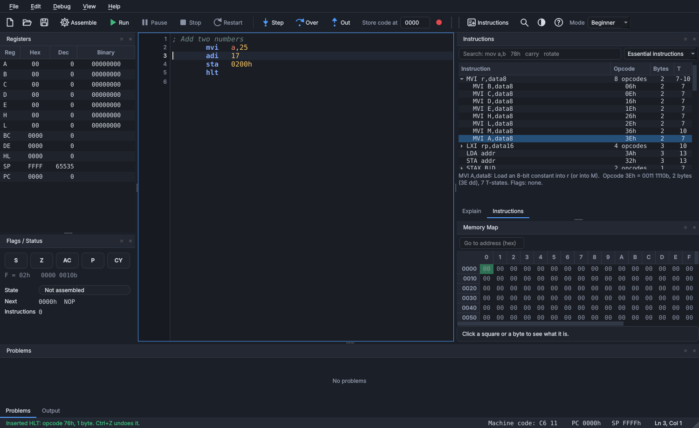

# User guide

## Contents
1. [Modes and layout](#1-modes-and-layout)
2. [The editor](#2-the-editor)
3. [Assembly syntax](#3-assembly-syntax)
4. [Running and debugging](#4-running-and-debugging)
5. [Explain panel and state changes](#5-explain-panel-and-state-changes)
6. [Registers, flags, memory, stack and I/O](#6-registers-flags-memory-stack-and-io)
7. [Memory heatmap](#7-memory-heatmap)
8. [Interrupts](#8-interrupts)
9. [Trace and export](#9-trace-and-export)
10. [Preferences, themes and accessibility](#10-preferences-themes-and-accessibility)
11. [Keyboard shortcuts](#11-keyboard-shortcuts)
12. [Troubleshooting](#12-troubleshooting)

## 1. Modes and layout
**Beginner** (default on first start) shows the editor, registers, flags, the Explain panel, a hex memory table, Problems
and Output. Heatmap controls, timing details, symbols, listing, stack, I/O ports and interrupts are hidden; the toolbar has
text labels. **Advanced** shows everything. Switch with the *Mode* box on the toolbar or *View > Interface mode*; each mode
remembers its own window layout. The first start opens *File > Examples > Beginner > 01 Your first program*; the 17 beginner
examples teach the essential instructions one idea at a time ([EXAMPLES.md](EXAMPLES.md)).

Every panel is a dock: drag it by its title, drop it on another to make tabs, float it, or hide it (*View* menu).
*View > Compact Layout* puts all panels in one tabbed column for small screens, *Focus Editor* (F12) hides every panel,
and *Reset Window Layout* restores the default for the current mode.

## 2. The editor
Line numbers, syntax colouring, auto-indent, `Ctrl+/` to comment lines, `Tab`/`Shift+Tab` to indent a selection, find bar
(`Ctrl+F`, `F3`), go to line (`Ctrl+G`), zoom (`Ctrl` + mouse wheel or `Ctrl` `+`/`-`). Hover over an instruction for its
syntax, flags, size and T-states; hover over a label for its value; hover over an underlined spot for the message.

The source is assembled as you type. **Red wavy** = error, **yellow wavy** = warning, **blue dotted** = compatibility note
(see [COMPATIBILITY.md](COMPATIBILITY.md)). The gutter shows a dot on lines with problems, a red disc for a breakpoint (hollow if the
line holds no code) and a yellow arrow on the line about to run.

A leading comment block with `; @key: value` lines is read as metadata (title, topic, chapter, level, validation) and shown in the Explain panel.

### Inserting instructions from the list
You never have to type an instruction. The **Instructions** panel lists the 8085 instruction set; **one click** puts the instruction into your
program. Typing by hand works exactly as before, and the two can be mixed freely.



- **Open it** with the *Instructions* button on the toolbar, `Ctrl+I`, *View > Instructions* or *Edit > Instructions*. In Beginner mode it is a tab
  next to *Explain* (the two tabs are at the bottom of that pane); in Advanced mode it is a tab beside *Interrupts*. `Ctrl+I` also works from Focus-editor mode.
- **Click an instruction** to insert it on its own line at the cursor: on the current line if that line is blank, otherwise on a new line below.
  The indentation of the line you are on is kept. If the instruction needs an operand, the placeholder (`00h`, `0000h` or `label`) is **selected**, so
  just type the value over it. **One `Ctrl+Z` undoes the whole insertion.** While a program is *running* the editor is locked; press Pause or Stop first.
- **Groups** such as `MOV r1,r2` or `ADD r` stand for several opcodes. Click the group to open it (only one stays open) and click the exact form, for
  example `MOV A,B`.
- **Opcodes are shown for every row.** *Opcode* is the first byte of the instruction in hexadecimal, *Bytes* is its length, and *T* its T-states (`7/10` for a
  conditional jump means 7 when the condition is false and 10 when it is true). Hover over a row, or select it, and the line under the list explains it: what it
  does, the opcode in binary (for `MOV A,B`: `0111 1000b`), the machine-code bytes (`3E dd` = opcode, then the data byte; `C3 lo hi` = opcode, then the
  address low byte, high byte) and which flags it changes.
- **Search** by instruction (`mov a,b`), by opcode (`78h`, `3E`) or by what it does (`carry`, `rotate`). `Enter` inserts a single match; `Down` moves from the
  search box into the list.
- **Scope** (the box next to the search): *Essential* is the set of instructions the 17 beginner examples use; *All* lists all 246 opcodes; the other entries
  list one group (data transfer, arithmetic, logic and rotate, branch, stack/I-O/control). The choice is remembered.
- **Machine code of the line you are on.** The status bar shows `Machine code: 3E 05` for the instruction under the cursor (it needs the program to assemble
  without errors on that line). The *Listing* panel (Advanced) shows the same bytes for the whole program.

## 3. Assembly syntax
```
[label:]  mnemonic  [operand[, operand]]      ; comment
```
- Numbers: `255`, `0FFh` (start with a digit), `0x1F`, `1010b`, `17o`, `'A'`, `$` (current address).
- Expressions: `+ - * / % & | ^ ~ << >>`, parentheses, `AND OR XOR NOT SHL SHR MOD HIGH LOW`, labels and constants.
- Directives: `ORG addr`, `DB list` (numbers and `"strings"`), `DW list`, `DS n[,fill]`, `name: EQU value`, `END [entry]`.
- Registers `A B C D E H L M SP PSW` cannot be used as labels. Labels are not case-sensitive.
- A comment line `;@` sets a breakpoint on the following line when the file is opened.
- `8` bit operands accept -128 to 255, 16-bit operands -32768 to 65535; anything else is an error (not silently truncated).

### Where the code is stored in memory
The **Store code at** box on the toolbar (in both modes) is the memory address, in hexadecimal, where the program's first byte is saved; execution starts there. Type an
address such as `2000` and press Enter, then Assemble or Run: the code is written at 2000h, the PC is set to it, and **Assemble** (F7) scrolls the Memory panel to it so you can
see the bytes (the status line reads *Assembled 12 byte(s), stored at 2000h*). Changing the box makes the loaded program out of date, so the next Run or Step assembles it again at the
new address; with *Keep memory* on, the copy at the old address is removed and your data elsewhere is left alone.

An **`ORG addr`** line in the source overrides the box for the code after it (`org 4000h` stores the next instruction at 4000h; several `ORG` lines place several blocks, for example code at
0000h and a table at 2000h). The box's starting value is *Preferences > Simulation > Default load address*.

## 4. Running and debugging
| Action | Key | What it does |
|---|---|---|
| Assemble | F7 | Assemble and load; stop at the first instruction |
| Run / Continue | F5 | Run to a breakpoint, `HLT`, an error, or until you Pause |
| Pause / Stop | F6 / Shift+F5 | Pause keeps the state; Stop returns to editing |
| Restart | Ctrl+Shift+F5 | Re-assemble and reload: registers/flags/PC/SP/interrupts/statistics reset, the program's own bytes written again. **Memory you entered and I/O port values are kept** (see [Keeping memory](#keeping-memory)) |
| Step Into | F11 | Execute one instruction (first press after editing assembles instead) |
| Step Over | F10 | Like Step Into, but a CALL/RST runs the whole routine |
| Step Out | Shift+F11 | Run until the current routine returns |
| Run to Cursor | Ctrl+F10 | Run until the line holding the text cursor |
| Breakpoint | F9 or click the gutter | Toggle |

The **Speed** box (Advanced) limits Run to 100,000 ... 1 instructions per second so that you can watch the panels change.
Editing is locked while a program is running. The simulator stops with an explanation on an illegal opcode, on a jump to itself with interrupts
disabled ("infinite loop"), and optionally after an instruction limit (*Preferences*).

## 5. Explain panel and state changes
**Next instruction** explains the instruction at PC using the real values: *"A = 3Fh, B = 01h -> A becomes 40h"*, which flags
it affects and which it leaves alone, its machine code and T-states, and for a conditional branch whether it **will** be taken right now.

**Predict first.** Tick *Predict first (hide the result)* at the top of the panel to hide everything the next instruction will
produce - the new register value, the carry decision, whether a branch is taken. The sentence saying what the instruction *does* and the
current input values stay visible, so you can work the answer out and then press **Step** to check it. The choice is remembered.

**What just happened** compares the state before and after the last step (or run): a table of every register, flag, SP, PC and IE that
changed, the memory bytes and ports that changed, and, after a single instruction, one sentence per changed flag explaining *why*
(for example the carry, borrow, parity or auxiliary-carry rule that applied, using your AC convention).

## 6. Registers, flags, memory, stack and I/O
- **Registers:** changed values are highlighted; double-click a Hex value to edit.
- **Flags:** click a flag button to toggle it. *Flags / Status* also shows the state (Ready, Running, Paused, Halted), the next instruction, the instruction count and (Advanced) the T-states and elapsed time at your chosen clock.
- **Memory:** a hex table of all 64 KB. Double-click a byte to edit. Click a byte to see, in the detail card, its address, symbol, value, whether it is program code (with the source line), DB/DW data, reserved DS storage, stack or unused, the read/write counts and the last access.
- **Stack** (Advanced): the bytes from SP upward, as 16-bit words with the label they point to.
- **I/O Ports** (Advanced): 256 ports; type a value to feed `IN`; ports written by `OUT` are highlighted and also logged in **Output**.
- **Symbols / Listing** (Advanced): labels with live contents; the assembler listing with addresses and bytes.

### Keeping memory
Memory is **kept** by default (*Preferences > Simulation > Keep memory contents when assembling, running and restarting*). A value you type into
the Memory panel, before or after assembling, is still there when you press Run, Step or Restart, and so are the results an earlier run left behind. This is
how a trainer kit behaves: enter the data, then run the program.

What assembling does to memory while this is on:
- the program's **code** and its **initialised data** (`DB`, `DW`, and `DS n,fill` with a fill value) are written again, so a program that changed its own
  code or a `DB` variable starts from the source's values at every run;
- space reserved with a plain **`DS n`** is *storage*: it is left as it is. A program that reads such a variable before writing it sees the value the
  last run left there. Write `DS n,0` if you want it set to zero at every assembly;
- bytes of the **previous version** of your program that you did not change are removed, so a shorter program leaves no stale code behind. Bytes you
  edited in that area are kept;
- everything else is not touched. Keep your data away from the program's own addresses (for example `ORG 2000h` for data), because the program's bytes win
  where they overlap.

Opening another file or example also keeps memory (only the old program's own bytes are removed). **Debug > Clear Memory and Heat** wipes memory whenever you
want a clean slate. Switch the option **off** if every run must start from the same clean memory, for example in a lab where results are compared: then every
assemble, Restart and file change wipes all of memory first.

## 7. Memory heatmap
Advanced mode, *Memory Map* panel. One square = 16 bytes (64 KB overview); double-click or use *Go to address* with *4 KB zoom* for
one square per byte.

| Colour | Meaning |
|---|---|
| Blue | byte **read** as data (`LDA`, `MOV A,M`, `POP`, ...) |
| Orange | byte **written** (`STA`, `MOV M,A`, `PUSH`, ...) |
| Green | instruction at that address **executed** - fetching an opcode counts here, **not** as a read |
| Green outline / yellow outline | PC / SP |

Modes: *Recent activity* (fades over the last 400 instructions), *Access frequency*, *Execution count*, *Contents*. Blue and orange were chosen because they stay distinguishable for the common forms of colour blindness; the *High Contrast* theme makes them brighter. This has not been tested with colour-blind users yet.

## 8. Interrupts
After reset `RST 7.5/6.5/5.5` are masked. Unmask with `MVI A,08h` / `SIM` (bit 3 = apply masks, bits 0-2 = mask 5.5/6.5/7.5), then `EI`.
`EI` takes effect after the next instruction. Use the **Interrupts** panel (Advanced) to raise `TRAP`, `RST 7.5/6.5/5.5` or `INTR` (with the `RST n` the device supplies) while the program
runs, is paused, or sleeps in `HLT`. A request that cannot be taken (masked or IE = 0) is explained in the status bar. The model is described in [ACCURACY.md](ACCURACY.md).

## 9. Trace and export
*Debug > Record Execution Trace* keeps one row per executed instruction (up to 100,000): number, address, source line, instruction, A B C D E H L,
SP, PC, the five flags, T-states, running T-states and events (memory writes, port I/O, interrupts). Registers and flags are the values **after**
the instruction. The **Trace** panel shows the latest 2,000 rows. *Export Trace...* writes **CSV**, **Markdown**, **HTML** or **PDF** (landscape A4).
Recording is off by default because it slows execution down.

## 10. Preferences, themes and accessibility
*File > Preferences*: theme, editor font and size (6-72 pt), interface font size, tab width, syntax colours (per theme, with reset), default load address (also the *Store code at* box), clock
frequency for the elapsed-time display, instruction limit, idle-loop detection, the AC subtraction convention, live checking, and the assembler syntax mode.

Themes: **Dark**, **Light**, **High Contrast** (`Ctrl+T` cycles). All three meet WCAG AA contrast (4.5:1 for text, 3:1 for marks) for the colours listed in `tools/contrast_check.py`; custom themes are not checked. Add your own as a JSON file in the user config folder (`themes/*.json`, see the README).
Keyboard-only use: every command has a menu entry or shortcut; Tab moves between panels; the focused control has a coloured outline; `Ctrl+E` returns to the editor.

## 11. Keyboard shortcuts
`F1` reference - `F3`/`Shift+F3` find next/previous - `F5` run - `F6` pause - `F7` assemble - `F9` breakpoint - `F10` step over - `F11` step into -
`Shift+F11` step out - `Ctrl+F10` run to cursor - `Shift+F5` stop - `Ctrl+Shift+F5` restart - `F12` focus editor - `Ctrl+F` find - `Ctrl+G` go to line -
`Ctrl+/` comment - `Ctrl+I` instruction list - `Ctrl+T` theme - `Ctrl+E` editor - `Ctrl+,` preferences.

## 12. Troubleshooting
| Symptom | Fix |
|---|---|
| Linux: *Could not load the Qt platform plugin "xcb"* | `sudo apt install libxcb-cursor0` (Fedora/Arch: `xcb-util-cursor`) |
| Program will not run | See the Problems panel; errors are listed with line and column |
| "Infinite loop" message | The program jumps to itself with interrupts disabled. Press Run again to keep spinning (for example while waiting for TRAP) |
| A step did nothing | The first press after editing assembles and stops at the first instruction |
| A second run gives a different answer | Memory is kept between runs, so a plain `DS` variable still holds the last result. Initialise it in the program, use `DS n,0`, run *Debug > Clear Memory and Heat*, or switch off *Keep memory* in Preferences |
| Memory I typed is gone after Run | The program's own bytes overwrite their addresses. Put the data at another address (`ORG 2000h`) or in the program with `DB` |
| Panels missing | *View > Reset Window Layout*, or switch the Mode |
